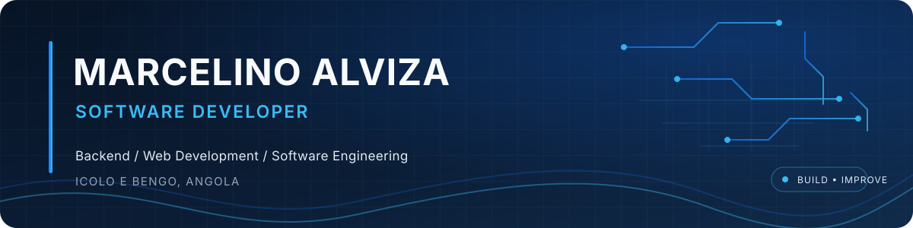
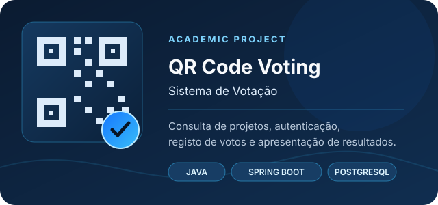
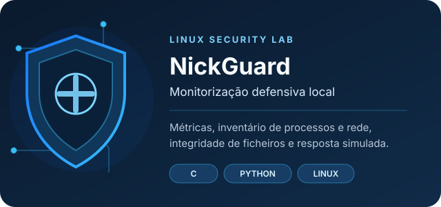
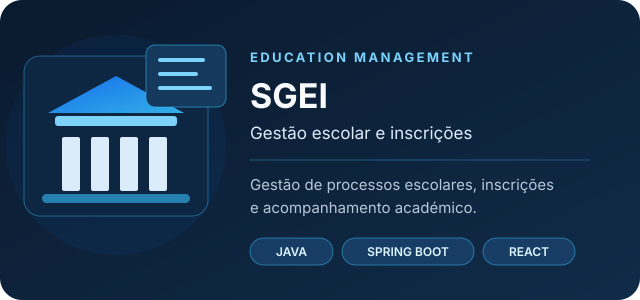
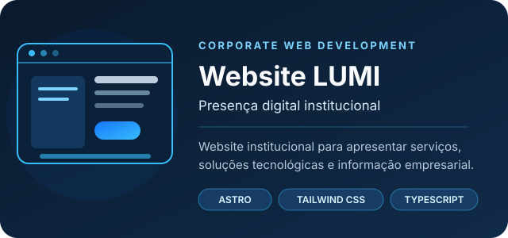

  

<h1 align="center">Marcelino Alviza</h1>

<h3 align="center">Software Developer | Backend & Web Development</h3>

  Icolo e Bengo, Angola

  <a href="mailto:alvizamarcelino7@gmail.com">Email</a>
  &nbsp;|&nbsp;
  <a href="https://wa.me/244947240912">WhatsApp</a>
  &nbsp;|&nbsp;
  <a href="https://github.com/BleyneAlviza">GitHub</a>

## Perfil profissional | Professional Profile

### Português

Sou finalista do Ensino Médio Técnico em Gestão de Redes e Sistemas Informáticos no Instituto Politécnico Privado Lucrécio dos Santos (IPPLS), em Angola.

Tenho interesse e experiência prática em desenvolvimento de software, com foco em Java, Spring Boot, desenvolvimento de APIs REST e integração com bases de dados relacionais.

Também trabalho com tecnologias de desenvolvimento Web, nomeadamente React, TypeScript, JavaScript, HTML e CSS.

Procuro desenvolver soluções funcionais, organizadas e seguras, valorizando a qualidade do código, a resolução de problemas, os testes e a melhoria contínua.

### English

I am a final-year technical secondary student in Network and Computer Systems Management at Instituto Politécnico Privado Lucrécio dos Santos (IPPLS), Angola.

I have a strong interest and practical experience in software development, focusing on Java, Spring Boot, REST API development, and relational database integration.

I also work with web development technologies, including React, TypeScript, JavaScript, HTML, and CSS.

My goal is to build functional, well-structured, and secure solutions while emphasizing code quality, problem-solving, testing, and continuous improvement.

## Tecnologias | Technical Skills

### Backend Development

  
  
  

### Frontend Development

  
  
  
  
  

### Databases & Infrastructure

  
  
  
  
  

### Development Tools

  
  
  
  

Additional experience with PostgreSQL/PostGIS, GraphQL, WebSockets, Flyway, MinIO, Docker Compose, automated testing, and Python development.

## Projetos em destaque | Featured Projects

<table>
  <tr>
    <td width="50%" align="center">
      
    </td>
    <td width="50%" align="center">
      
    </td>
  </tr>
  <tr>
    <td width="50%" align="center">
      
    </td>
    <td width="50%" align="center">
      
    </td>
  </tr>
</table>

## Metodologia de desenvolvimento | Development Approach

| Fase | Descrição |
|:---:|---|
| 01 | Análise de requisitos e problemas |
| 02 | Planeamento e arquitetura |
| 03 | Desenvolvimento e implementação |
| 04 | Testes e validação |
| 05 | Revisão e melhoria do código |
| 06 | Documentação e manutenção |

---

## Contacto | Contact

| Informação | Contacto |
|---|---|
| Email | [alvizamarcelino7@gmail.com](mailto:alvizamarcelino7@gmail.com) |
| Telefone / WhatsApp | +244 947 240 912 |
| Localização | Icolo e Bengo, Angola |
| GitHub | [BleyneAlviza](https://github.com/BleyneAlviza) |
| Portefólio | Em desenvolvimento |

---

  <strong>Construindo soluções digitais através da tecnologia.</strong>
   
  Building digital solutions through technology.

